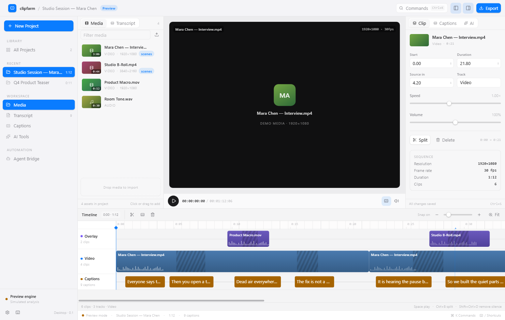
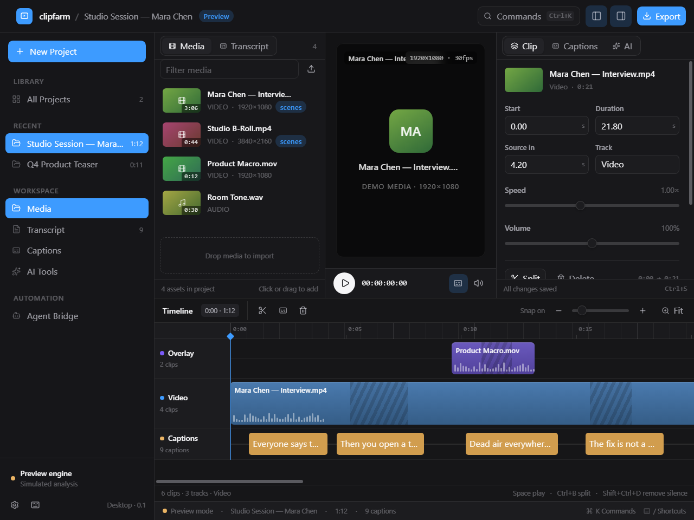
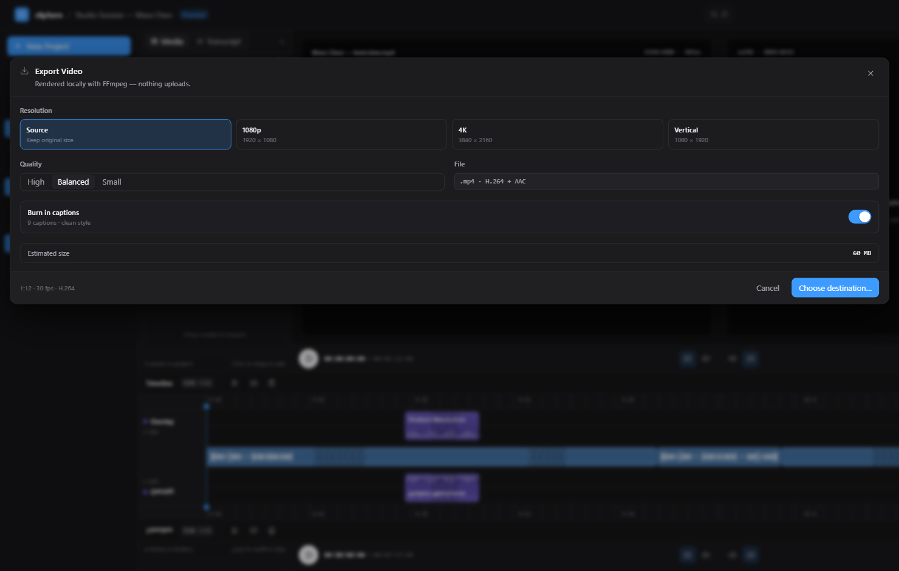
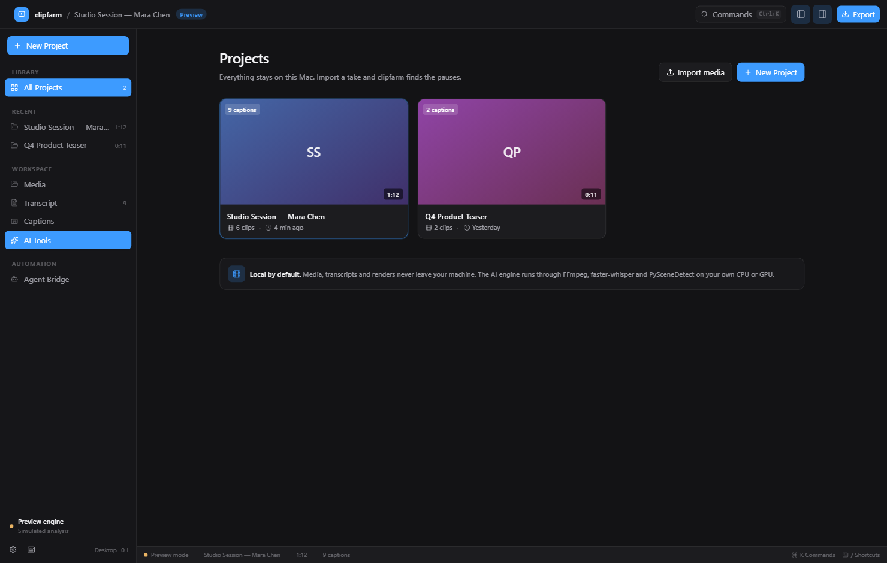
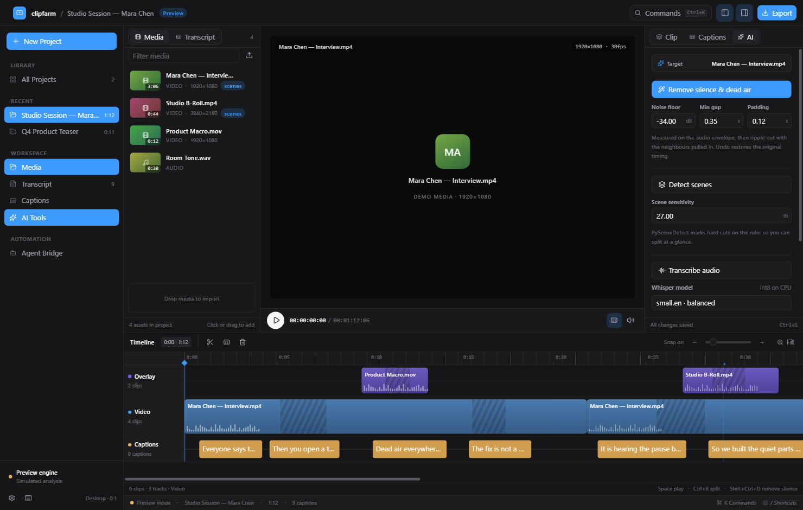

# clipfarm

A local-first desktop video editor for talking-head footage. Drop in a take,
remove the dead air, read the transcript, cut with word-level captions, and export
— all on your own machine, with an MCP bridge so coding agents can edit the
timeline too.

Built with Electron, React, TypeScript, Tailwind CSS, FFmpeg, faster-whisper and
PySceneDetect. The interface follows Apple's Human Interface Guidelines for desktop
(see [docs/design-review.md](docs/design-review.md)).



## Why it exists

Editing an interview is mostly listening, not clicking. clipfarm treats the audio
envelope and the transcript as first-class timeline data:

- silence is detected on the waveform and ripple-cut with a single command
- every cut is undoable and never clips a phoneme (configurable padding)
- captions carry per-word timestamps, so trimming and dead-air removal keep them aligned
- nothing uploads; the AI runs on the same CPU/GPU that holds the footage

## Features

- **Native-feeling desktop shell** — translucent sidebar and title bar, system
  Light/Dark, resizable split layout, native menu bar with accelerators, a ⌘K
  command palette, and a full keyboard editing model.
- **Timeline** — video, overlay and caption tracks; drag/trim with edge snapping;
  scene markers; silence zones; zoom and fit; 30 fps timecode.
- **Silence removal** — FFmpeg `silencedetect` with auto-editor-style padding and
  ripple behaviour. Adjust noise floor, minimum gap and padding in the AI inspector.
- **Scene splitting** — PySceneDetect content detector, with sensitivity control;
  boundaries appear on the ruler and drive Previous/Next Scene.
- **Transcription** — faster-whisper with `word_timestamps=True`, quantized `int8`,
  automatic CPU/CUDA selection, VAD, five model sizes. Captions are grouped into
  readable lines and stay editable.
- **Export** — H.264/AAC MP4 with source/1080p/4K/vertical presets, three quality
  levels, optional burned-in captions in three styles, determinate progress and
  cancel. Audio is normalised to −16 LUFS.
- **Agent Bridge** — a dependency-free MCP server over stdio that can read the
  timeline and place, trim, split, caption, clean and export. Copy-paste client
  config is generated from the app.

## Screenshots

| Dark appearance | Export sheet |
| --- | --- |
|  |  |

| Project library | AI inspector |
| --- | --- |
|  |  |

## Architecture

```
┌─────────────────────────── Electron ───────────────────────────┐
│  main process                                                  │
│   • window, native menu, IPC                                   │
│   • project store (atomic JSON in userData)                    │
│   • clipfarm-media:// range-aware protocol for local playback  │
│   • job manager ── stdio JSON-RPC ──┐                          │
│  preload (contextBridge, typed API)  │                          │
│  renderer (React 19 + Tailwind 4)    │                          │
│   • studio store, undo, autosave     │                          │
│   • timeline / preview / inspector   │                          │
└──────────────────────────────────────┼─────────────────────────┘
                                       ▼
                        python/clipfarm_core (sidecar + MCP)
                         • project.py / timeline.py  (pure stdlib)
                         • silence.py   FFmpeg silencedetect
                         • scenes.py    PySceneDetect
                         • transcribe.py faster-whisper int8
                         • render.py    FFmpeg filter graph + captions
                         • rpc.py       JSON-RPC server for the app
                         • mcp_server.py MCP tools for agents
```

The Python core is standard-library-only until you install the AI extras, so the
timeline, MCP server and project IO work even on a bare interpreter. FFmpeg is the
only hard external dependency.

## Requirements

| Component | Version |
| --- | --- |
| Node.js | 20+ (this repo was built with 26) |
| Python | 3.10+ |
| FFmpeg + FFprobe | 5.0+ on `PATH` |
| AI extras (optional) | faster-whisper, PySceneDetect, NumPy |

Install FFmpeg:

```bash
# macOS
brew install ffmpeg
# Windows
winget install Gyan.FFmpeg
# Debian/Ubuntu
sudo apt install ffmpeg
```

## Quick start

```bash
git clone https://github.com/<your-account>/clipfarm.git
cd clipfarm
npm install
npm run python:setup   # creates .venv and installs the AI extras
npm run dev            # launches the desktop app
```

`npm run python:setup` installs `python/requirements-ai.txt` into `.venv`. The main
process prefers `CLIPFARM_PYTHON`, then `.venv`, then `python3`, and reports each
capability in **Settings → Media engine**. A missing FFmpeg or Whisper shows as a
warning with the exact install command — nothing fails silently.

To iterate on the UI in a browser (seeded demo project, simulated analysis):

```bash
npm run dev:web        # http://localhost:3000
```

The renderer detects the missing preload bridge and swaps in a demo backend
(`src/renderer/src/lib/demo.ts`), so design work never needs Electron.

### Build installers

```bash
npm run dist:mac       # dmg + zip (hardened runtime entitlements in build/)
npm run dist:win       # NSIS x64 + arm64
npm run dist:linux     # AppImage
```

Packaging copies `python/clipfarm_core` as an extra resource. The end user still
needs Python and (for transcription) the AI extras; the app points at the same
`.venv` resolution logic and reports what is missing. Set `CLIPFARM_PYTHON` to a
frozen interpreter or a shim if you ship your own runtime.

## Using clipfarm

1. **New Project** → drag media into the bin (or ⌘I). Files are referenced, not copied.
2. **Remove Silence** (⇧⌘D) or use **AI Tools** to tune the noise floor, gap and padding.
   The timeline ripples; ⌘Z restores the original timing.
3. **Transcribe** (⌘T) after picking a Whisper model. Captions land on the captions
   track and in the Transcript panel; click any line to seek.
4. **Edit**: drag clips, drag their edges to trim, ⌘B to split at the playhead,
   ⌥←/→ to jump between detected scenes, ⌘K for every command.
5. **Export** (⇧⌘E), choose a preset, optionally burn in captions, and pick a destination.

### Keyboard shortcuts

| Shortcut | Action |
| --- | --- |
| Space | Play / pause |
| J / K / L | Rewind / pause / play forward |
| ⌘B | Split at playhead |
| ⇧⌘D | Remove silence & dead air |
| ⇧⌘C | Detect scenes |
| ⌘T | Transcribe |
| ⌘I | Import media |
| ⌘S | Save now (autosave is always on) |
| ⌘Z / ⇧⌘Z | Undo / redo |
| ⌘K | Command palette |
| ⌘1–4 | Library / Media / Transcript / Agent Bridge |
| ⌥⌘S | Toggle sidebar |
| ⌥⌘I | Toggle inspector |
| ⌘/ | All shortcuts |
| ⌘, | Settings |

## Agent Bridge (MCP)

The desktop app generates a ready-to-paste config in **Agent Bridge** (⌘4). It runs
the same Python package as a stdio MCP server pointed at the open project file:

```json
{
  "mcpServers": {
    "clipfarm": {
      "command": "/path/to/clipfarm/.venv/bin/python",
      "args": [
        "-m",
        "clipfarm_core",
        "mcp",
        "--project",
        "/Users/you/Library/Application Support/clipfarm/projects/<id>.json"
      ],
      "env": { "PYTHONPATH": "/path/to/clipfarm/python" }
    }
  }
}
```

Tools: `clipfarm_get_timeline`, `clipfarm_list_assets`, `clipfarm_place_clip`,
`clipfarm_trim_clip`, `clipfarm_split_clip`, `clipfarm_delete_clip`,
`clipfarm_add_caption`, `clipfarm_remove_silences`, `clipfarm_detect_scenes`,
`clipfarm_transcribe`, `clipfarm_export`. Full schemas and the project JSON contract
are in [docs/PROJECT_FORMAT.md](docs/PROJECT_FORMAT.md).

Example request to an assistant:

> Read the clipfarm timeline, remove the dead air from the interview, add a caption
> at every scene start, then export a 1080p cut to ~/Movies/interview-cut.mp4.

The server is stdio-only: no port, no account, no network listener. Every mutation
writes to the project file, so the open app picks it up and the action stays
reviewable/undoable in the UI.

## Data and privacy

Everything is local:

- projects: `<userData>/projects/<id>.json`
- thumbnails: `<userData>/thumbnails/`
- Whisper models: `~/.cache/clipfarm/models` (override with `CLIPFARM_MODEL_DIR`)
- renders: wherever you choose

Media is served to the renderer through a custom `clipfarm-media://` protocol with
range support; the renderer never receives raw filesystem access. Only a model
download on first transcription touches the network.

## Project layout

```
clipfarm/
├─ .design-rules/            Apple HIG skill (123 guideline pages) used for review
├─ build/                    packaging entitlements + app icon
├─ docs/
│  ├─ design-review.md       HIG audit with citations and known gaps
│  ├─ PROJECT_FORMAT.md      project JSON + MCP tool contract
│  └─ screenshots/
├─ python/
│  ├─ clipfarm_core/         local media engine and MCP server
│  └─ tests/                 unit tests + FFmpeg integration tests
├─ src/
│  ├─ main/                  Electron main: window, menu, store, jobs, protocol
│  ├─ preload/               typed contextBridge API
│  ├─ renderer/              React UI
│  └─ shared/types.ts        contract shared by all three
├─ electron.vite.config.ts
├─ vite.renderer.config.ts   browser preview of the renderer
└─ electron-builder.yml
```

## Tests and checks

```bash
npm run typecheck                       # main, preload and renderer
npm run build                           # typecheck + production bundles
npm run python:test                     # unit tests (FFmpeg integration auto-skips)

# End-to-end media pipeline (needs FFmpeg on PATH)
PYTHONPATH=python python3 -m unittest python/tests/test_ffmpeg_integration.py -v
```

The integration test generates an 8-second clip with a two-second silent gap, then
verifies FFprobe metadata, silence detection (start/end accuracy) and a real render
with burned-in captions.

## Design

The UI was built and reviewed against Apple's Human Interface Guidelines using the
`dickwu/apple-design-skill` clone in `.design-rules/`:

- functional layer (title bar, sidebar, transport) vs content layer (media, timeline)
- semantic colors with system Light/Dark, no app-level appearance override
- 8/16 pt spacing rhythm, 30–32 px control heights, 11–13 pt desktop type
- determinate progress with stage text and cancel; quiet success, actionable errors
- native menu parity, standard shortcuts preserved, every command discoverable

The audit, with file-level citations and an honest list of unverified items
(VoiceOver pass, Windows/Linux chrome, reduced-transparency inspection), is in
[docs/design-review.md](docs/design-review.md).

## Troubleshooting

**"FFmpeg is missing"** — install it and press *Check again* in Settings. The app
looks for `ffmpeg`/`ffprobe` on `PATH`, including PATH inherited at launch.

**Transcription says faster-whisper is not installed** — run `npm run python:setup`,
or point `CLIPFARM_PYTHON` at an interpreter that has it.

**First transcription is slow** — the model (default `small.en`, int8) downloads once.
Use `tiny.en` for quick drafts; on Apple silicon and NVIDIA, CTranslate2 picks a
faster device automatically.

**Scenes detect nothing** — raise or lower *Scene sensitivity* (content threshold).
Hard cuts work best; long dissolves may need a lower threshold.

**Silence removal cuts too aggressively** — increase Padding to 0.2–0.3 s, raise the
noise floor toward −30 dB, or raise Min gap.

**MCP client cannot find clipfarm_core** — set `PYTHONPATH` to the repository's
`python/` directory (the generated config already does), or install the package with
`pip install -e python`.

## Credits

- Silence detection is inspired by [auto-editor](https://github.com/WyattBlue/auto-editor);
  clipfarm implements its own FFmpeg-based pass so it can ripple the timeline directly.
- [faster-whisper](https://github.com/SYSTRAN/faster-whisper) (MIT) and CTranslate2 for
  local speech recognition.
- [PySceneDetect](https://github.com/Breakthrough/PySceneDetect) for shot boundaries.
- [Apple Design Skill](https://github.com/dickwu/apple-design-skill) for the HIG
  reference and review framework.
- Icons by [Lucide](https://lucide.dev).

## License

MIT — see [LICENSE](LICENSE).

## Publishing this repository

The working tree is already a git repository with an initial commit on `main`. To
publish it with the GitHub CLI:

```bash
gh repo create clipfarm --public --source=. --remote=origin --push
```

Or with a remote you created yourself:

```bash
git remote add origin git@github.com:<your-account>/clipfarm.git
git branch -M main
git push -u origin main
```

`.design-rules/` is committed as reference material for design reviews; remove it
from `.gitignore`-free history if you prefer to add it as a submodule instead.
