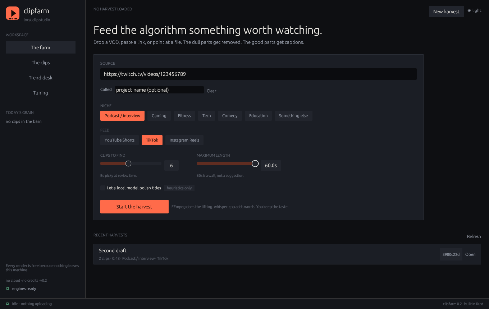
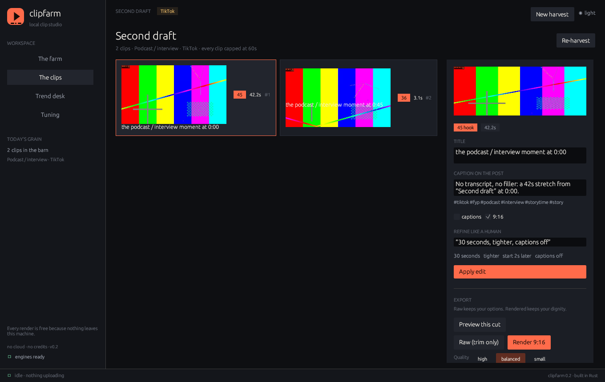
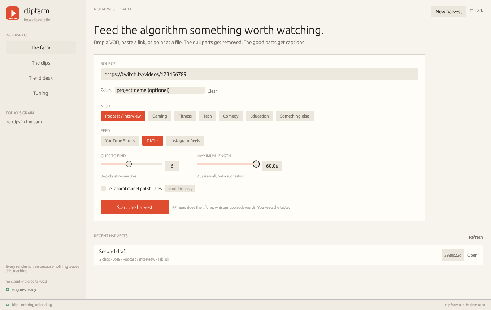
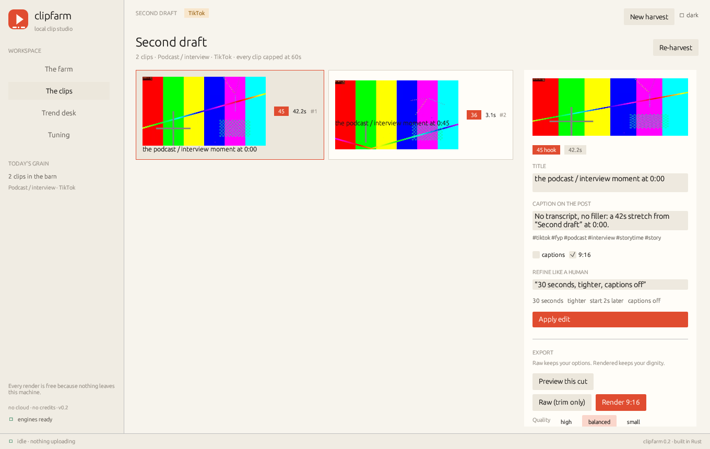

# clipfarm

**Long video in. Shorts out. No cloud, no credits.**

clipfarm is a desktop clipping studio for turning a stream, podcast or local recording
into review-ready short-form clips. It pulls the VOD, finds the moments worth posting,
caps every clip at **60 seconds**, captions them, reframes to 9:16, and exports — or
gets out of the way and hands you a raw trim for Premiere, Resolve or CapCut.

Everything is written in **Rust**: the media engine, the CLI, and the desktop UI
(egui/eframe). There is no Electron, no embedded Chromium, no Python runtime, and no
paid inference API.

```
long VOD ──► speech/VAD ──► clip planning ──► review ──┬─► raw trim (stream copy)
             + whisper.cpp    (hooks, scores)          └─► 9:16 short + captions
```

## Download

| Platform | Link |
| --- | --- |
| **macOS** (Apple silicon & Intel, `.dmg`) | _Coming soon_ — queued in CI (macOS runners unavailable at the moment) |
| **Windows** (NSIS installer, `.exe`) | [clipfarm-app_0.2.0_x64-setup.exe](https://github.com/shycodelix/clipfarm/releases/download/v0.2.0/clipfarm-app_0.2.0_x64-setup.exe) |
| **Linux** (Debian/Ubuntu, `.deb`) | [clipfarm-x86_64-unknown-linux-gnu.deb](https://github.com/shycodelix/clipfarm/releases/download/v0.2.0/clipfarm-x86_64-unknown-linux-gnu.deb) |

Past releases are in [Releases](https://github.com/shycodelix/clipfarm/releases).

### What the installers include

Each installer ships the **`clipfarm`** CLI as well as the desktop app:

- **Windows** — CLI added to PATH during install; Start menu and Desktop shortcuts;
  built-in uninstaller.
- **Linux** — CLI at `/usr/bin/clipfarm` (and `/usr/bin/clipfarm-app`); desktop entry.
- **macOS** — CLI lives inside the `.app` bundle at `clipfarm.app/Contents/MacOS/clipfarm`
  (run it from Terminal, or add a symlink).

## Screenshots

Both rooms in both palettes, rendered from the real app (headless Linux, 1440×900):

| The farm — dark | The clips room — dark |
| --- | --- |
|  |  |
| **The farm — light** | **The clips room — light** |
|  |  |

## What it does

- **Ingest anything local, or paste a link.** Local files are referenced, never copied.
  URLs are fetched with [yt-dlp](https://github.com/yt-dlp/yt-dlp) (YouTube, Twitch,
  and the rest of its long tail).
- **Find the spoken parts, not the silence.** A streaming FFmpeg-backed energy VAD
  finds speech; optional [whisper.cpp](https://github.com/ggerganov/whisper.cpp) adds
  word-level timestamps, captions and transcript-aware hook scoring.
- **Plan clips like an editor.** Utterances are joined across natural pauses, split
  before they can grow past the ceiling, scored on speech density, energy, opening
  lines, niche keywords and reactions, then ranked.
- **The 60-second wall.** Clips are clamped when planned, saved, refined and exported.
  A test proves a 5-minute monologue becomes multiple ≤60s clips and that a 61s clip
  is refused.
- **Raw bypass.** One click writes a stream-copy trim (no captions, no reframe) for
  external NLEs. If a keyframe cut overshoots 60s, clipfarm re-encodes that file at
  CRF 16 rather than break the ceiling.
- **Rendered shorts.** 1080×1920 H.264/AAC with a heuristic subject-aware crop,
  burned-in captions (Clean/Bold/Karaoke), faststart, and hardware H.264 when the
  machine exposes VideoToolbox, NVENC, Quick Sync or AMF.
- **Refine in plain English.** “make it 30 seconds, tighter, captions off” becomes
  explicit, reversible clip operations. Unknown requests can be routed to a **local**
  model, never a paid API.
- **Metadata without the cringe.** Titles, one-line captions and hashtags are generated
  offline from the niche and the words actually spoken. An optional local Ollama model
  can polish them.
- **Trend-aware pacing, honestly labeled.** Bundled profiles per niche and platform
  set clip length, cut rhythm, caption style and hashtags. They are opinionated
  starting points, not scraped trend data — and you can override them with your own
  JSON feed.

## Quick start

### Requirements

| Tool | Needed? | Notes |
| --- | --- | --- |
| **FFmpeg + ffprobe** | required | Only hard dependency. 5.0+; 7.x recommended. A build with libass is needed to burn captions. |
| **yt-dlp** | for URLs | `pipx install yt-dlp`, `brew install yt-dlp`, `winget install yt-dlp` |
| **whisper.cpp** | optional | Word-level captions. Without it clipfarm runs VAD-only. Needs a `ggml-*.bin` model. |
| **Ollama** (or any loopback OpenAI-ish JSON endpoint) | optional | Local title/refine assistance. Off by default. |
| **Rust 1.80+** | build only | `rustup` installs it. |

Install FFmpeg:

```bash
# macOS
brew install ffmpeg
# Windows
winget install Gyan.FFmpeg        # or: choco install ffmpeg
# Debian / Ubuntu
sudo apt install ffmpeg
```

### Use the CLI

```bash
cargo run --release -p clipfarm-cli -- doctor

# Local file, or paste a URL
cargo run --release -p clipfarm-cli -- ingest ~/Videos/interview.mp4 \
  --niche podcast --platform tiktok --clips 6

cargo run --release -p clipfarm-cli -- clips <project-id>
cargo run --release -p clipfarm-cli -- refine <project-id> 1 "make it 30 seconds, tighter"
cargo run --release -p clipfarm-cli -- export <project-id> 1 --raw
cargo run --release -p clipfarm-cli -- export <project-id> 1
```

The first run prints the project id. Everything lands in the clipfarm data directory
(see [Where things live](#where-things-live)).

### Open the desktop app

```bash
cargo run --release -p clipfarm-app
```

The app has four rooms:

- **The farm** — drop a file or paste a URL, pick a niche and feed, set the clip count
  and ceiling, start the harvest.
- **The clips** — thumbnail grid, hook scores, inline title/caption editing, refine
  chat, caption/vertical toggles, raw and rendered export.
- **Trend desk** — the pacing profile clipfarm followed, and the same niche on other
  feeds. Apply a caption style to the whole harvest.
- **Tuning** — tool discovery, binary paths, local-model switch, data locations and
  shortcuts.

Paths are read from the text field; drag-and-drop works on the farm screen. The app
is keyboard-operable (`⌘/Ctrl+1…4`, `⌘/Ctrl+E`, `⌘/Ctrl+N`, `Esc`).

## Install

### 1. Native packages

The release workflow builds platform installers from the same source and attaches them to
GitHub Releases:

| Platform | Format | Notes |
| --- | --- | --- |
| macOS | `.dmg` | Apple silicon and Intel; FFmpeg recommended via Homebrew |
| Windows | NSIS `.exe` | Per-user installer with Start menu/Desktop shortcuts and an uninstaller |
| Linux | `.deb` | System package with a desktop entry |

Grab them from the **Download** section above (or [Releases](https://github.com/shycodelix/clipfarm/releases) for older versions). Local packaging is documented in [docs/PLATFORM.md](docs/PLATFORM.md).

```bash
# From a git checkout, anywhere Rust is installed
cargo install --git https://github.com/<your-account>/clipfarm clipfarm-cli

# Homebrew / winget formulae are planned but not published; use the installer or
# cargo install until they are.
```

### Build from source

```bash
git clone https://github.com/<your-account>/clipfarm.git
cd clipfarm

# Linux build prerequisites for the window (Debian/Ubuntu)
sudo apt install build-essential pkg-config libxkbcommon-dev libwayland-dev libx11-dev

cargo build --release -p clipfarm-cli
cargo build --release -p clipfarm-app

./target/release/clipfarm doctor
./target/release/clipfarm-app
```

## How a harvest works

1. **Ingest.** `yt-dlp` downloads to the project folder, or a local file is referenced
   in place. FFprobe records duration, resolution, fps and stream info.
2. **Listen.** FFmpeg decodes mono 16 kHz PCM into a streaming VAD (30 ms frames,
   RMS threshold, silence hangover, padding). A three-hour VOD never fits in memory.
3. **Transcribe (optional).** whisper.cpp writes one-word segments with millisecond
   offsets (`--output-json --max-len 1 --split-on-word`); clipfarm normalizes them into
   a transcript. Missing whisper is a warning, not a failure.
4. **Plan.** Speech is joined across pauses (≈1.2–3.2 s depending on feed tempo),
   long monologues are split under the ceiling, and each candidate is scored 0–100 for
   speech density, level, opening question, niche keywords, reactions and pace.
5. **Dress.** Titles/captions/hashtags come from the transcript and the niche profile;
   captions are grouped into ≤42-character, ≤3.6 s lines; thumbnails are extracted.
6. **Review and refine.** Edits are explicit ops on the clip — duration, in-point,
   tighten, captions, aspect, filler removal, title/caption. Nothing is hidden.
7. **Export.** Raw uses `-c copy`; rendered crops/pads to 1080×1920, burns SRT through
   libass, encodes H.264 + AAC with the best available encoder, and always re-checks
   the 60s ceiling.

## Zero-cost AI, enforced

There are no API keys and no credit meter. The optional assistant is Ollama (or a
compatible local server) and the guard lives in the engine, not the UI:

```rust
if !is_loopback(endpoint) {
    return Err("Refusing to call `…`: clipfarm only talks to a local model.");
}
```

`https://api.openai.com`, a tunnel, or `http://127.0.0.1.evil.example` are all rejected
before a request is made. Metadata generation and refinement work without any model at
all; the model only improves phrasing and catches fuzzy intent.

## Trend profiles

`clipfarm trends` lists the bundled profiles. Each one sets:

- target clip window (`min_seconds`–`max_seconds`), always capped at 60
- cut cadence (`cut_every`) and a caption style
- hook patterns with a `{topic}` slot
- platform and niche hashtags
- short editorial notes

Override them by dropping a JSON array at `<data>/trends.json` (same shape as
`TrendProfile` in `crates/clipfarm-core/src/trends.rs`). This is the integration point
for a scheduled trend job you control; clipfarm itself does not scrape feeds or
pretend to know today's meme.

## Where things live

| What | Where |
| --- | --- |
| Projects (JSON) | `<data>/projects/<uuid>.json` |
| Downloaded media, thumbnails, whisper work files | `<data>/media/<project-uuid>/` |
| Exports | `<data>/exports/<project-slug>/` |
| Config | `<data>/config.json` |
| Trend overrides | `<data>/trends.json` |

`<data>` is the OS data directory (`~/Library/Application Support/clipfarm` on macOS,
`%APPDATA%\clipfarm` on Windows, `~/.local/share/clipfarm` on Linux), unless
`CLIPFARM_HOME` is set. Source files are never modified.

## Configuration

Environment variables win over `config.json`:

| Variable | Purpose |
| --- | --- |
| `CLIPFARM_HOME` | Data directory |
| `CLIPFARM_FFMPEG`, `CLIPFARM_FFPROBE` | Explicit binary paths |
| `CLIPFARM_YTDLP` | yt-dlp path |
| `CLIPFARM_WHISPER` | whisper.cpp CLI (`whisper-cli` or `main`) |
| `CLIPFARM_WHISPER_MODEL` | `ggml-base.en.bin`, `ggml-small.en.bin`, … |
| `OLLAMA_HOST` | Local assistant endpoint (loopback only) |
| `CLIPFARM_LLM_MODEL` | Model name, default `llama3.2` |

## Tests

```bash
cargo fmt --check
cargo test --workspace            # 36 unit tests + engine tests

# Real FFmpeg pipeline: ingest → VAD → plan → thumbnails → raw + 1080×1920 export
CLIPFARM_TEST_FFMPEG=/path/to/ffmpeg cargo test -p clipfarm-core --test ffmpeg_pipeline -- --nocapture
```

The integration test generates a 36-second 720p fixture with alternating speech and
silence, proves every planned clip is ≤60s, checks thumbnails, exports a raw trim and a
1080×1920 render, and asserts a 61-second clip is rejected.

The desktop UI is compile-checked in CI. Headless Linux runners cannot open a window,
so the UI needs a manual visual pass on a machine with a display (see the honest status
in [docs/PLATFORM.md](docs/PLATFORM.md#verification-status)).

## Limitations

- **whisper.cpp is a CLI integration**, not linked bindings; the exact JSON shape is
  parsed defensively, and a missing model degrades to VAD-only.
- **Smart framing is a heuristic** (column edge-energy over a sampled frame), not
  OpenCV/ONNX face tracking. A model-backed tracker is an extension point in
  `media::focus_center`.
- **Trend profiles are curated, not live-scraped.** Real-time trend ingestion is left
  to a feed you control; this avoids ToS and rate-limit games.
- **Raw trims are keyframe-accurate**, so the first frame may precede the requested
  in-point. Use a rendered clip when frame accuracy matters.
- **Captions need libass.** Without it, rendered clips still export and an `.srt`
  sidecar is written.
- **Previewing a cut renders a small file and opens it in your system player.** There
  is no in-app, frame-accurate video preview yet; that is the next milestone.
- **Mobile is not shipped.** The core is portable, but the desktop UI and binary
  dependencies are not. See [docs/PLATFORM.md](docs/PLATFORM.md#mobile-feasibility).

## Repository layout

```
clipfarm/
├─ .design-rules/              Apple HIG reference clone, used for UI review
├─ build/icon.png              app icon (generated by scripts/make-icon.py)
├─ crates/
│  ├─ clipfarm-core/           engine: ingest, VAD, whisper, planning, metadata,
│  │                           trends, refine, FFmpeg export, project store
│  ├─ clipfarm-cli/            `clipfarm` command line
│  └─ clipfarm-app/            Rust desktop UI (egui/eframe)
├─ docs/
│  ├─ ARCHITECTURE.md          data flow, invariants, extension points
│  └─ PLATFORM.md              packaging, OS prerequisites, mobile feasibility
├─ .github/workflows/          CI and installer builds
└─ scripts/make-icon.py
```

## Credits

- [FFmpeg](https://ffmpeg.org/) for decode, analysis and encode; [ffmpeg-next] was not
  used because subprocess orchestration gives clearer progress, cancellation and
  licensing boundaries.
- [yt-dlp](https://github.com/yt-dlp/yt-dlp) for VOD ingestion.
- [whisper.cpp](https://github.com/ggerganov/whisper.cpp) for local word-level ASR.
- [Ollama](https://ollama.com/) for optional loopback inference.
- [egui / eframe](https://github.com/emilk/egui) for the Rust-native UI.
- [Apple Design Skill](https://github.com/dickwu/apple-design-skill) for the HIG
  reference used during design review.

## License

MIT — see [LICENSE](LICENSE).

## Publishing this repository

The working tree is a git repository with a commit on `main`. Publish it with:

```bash
gh repo create clipfarm --public --source=. --remote=origin --push
```

or:

```bash
git remote add origin git@github.com:<your-account>/clipfarm.git
git push -u origin main
```
